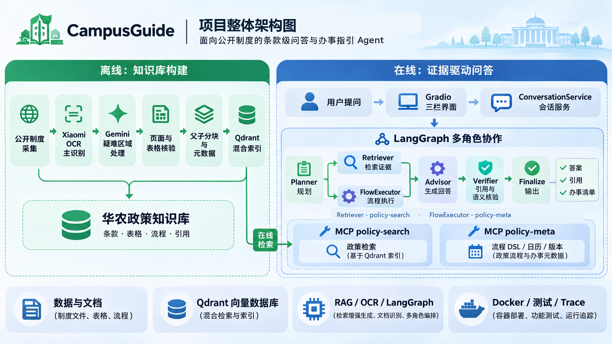
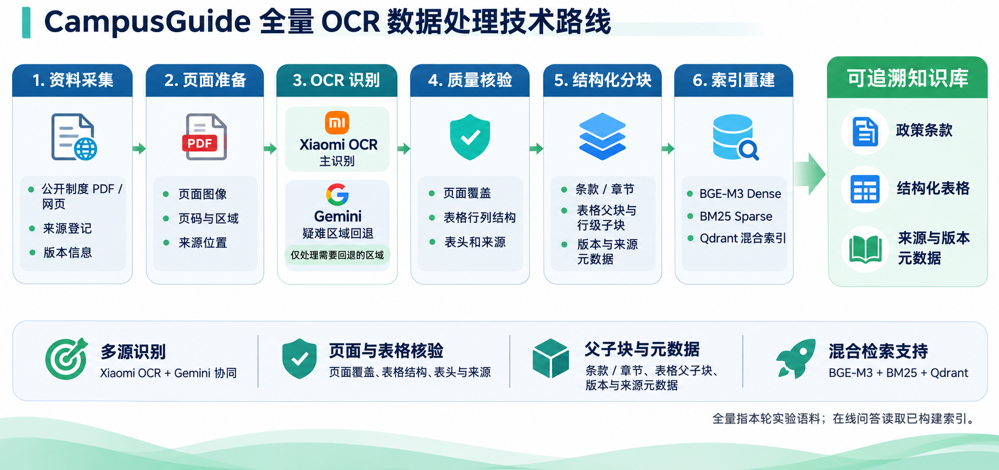
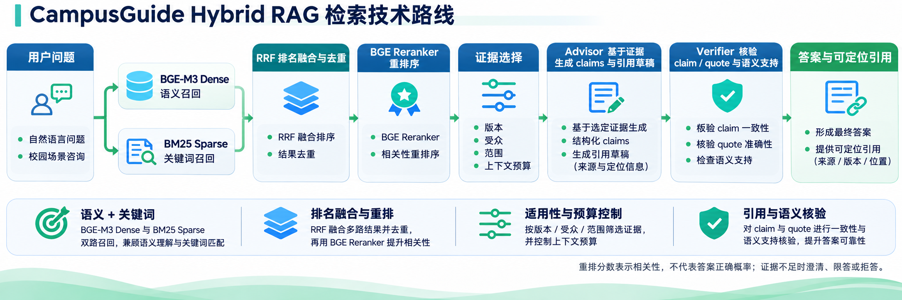
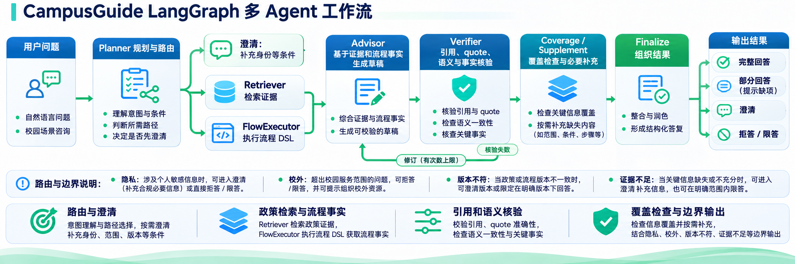
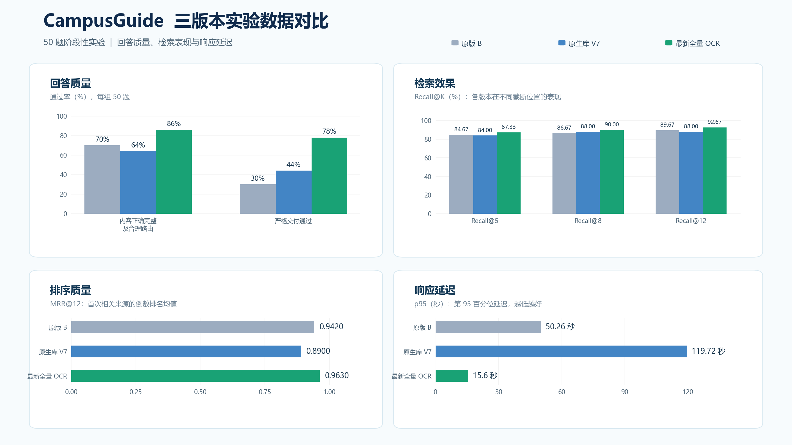

# CampusGuide

面向华南农业大学公开制度的**条款级问答与办事指引 Agent**（个人作品集项目）。

答案由检索证据 + claim/quote 校验 + 语义核对生成；流程事实由流程 DSL 渲染成 checklist；证据不足、隐私、校外或版本不符时明确拒答或限答；部分回答只展示通过核验的结论并提示缺项。本轮已完成全量 OCR 与索引重建，内容及合理路由通过率为 86%，严格交付通过率为 78%，详见下方实验对比。

> 个人演示项目，不构成官方答复。具体政策以学校官网和负责部门解释为准。请勿输入学号、身份证、成绩单等个人信息。


`条款级 RAG` · `MCP 工具层` · `LangGraph 四角色` · `流程 checklist` · `引用/语义核对` · `三栏 Gradio UI`

## 30 秒看懂

- **不是**把整篇制度丢给模型总结：每个结论必须绑定本轮检索到的条款和可定位 quote；
- **多轮流程**：国奖申请、推免资格、在读证明有确定性槽位、closed 状态和 checklist；
- **失败关闭**：无证据、引用不支持、版本冲突、隐私、校外问题都有明确 outcome；
- **可演示**：三栏页面、历史恢复、移动端抽屉/底部卡片、节点进度、引用与调试面板；
- **可复现**：本地 host 或 Docker Compose；fake backend 不加载模型也能跑 UI 测试。

## 项目结构与处理流程



项目分为离线知识库建设与在线问答两条链路：**资料搜索与采集 → OCR 解析入库 → 检索 → 重排序 → LLM 基于证据回答 → 引用与事实核验**。当前实验语料已完成全量 OCR，主识别采用 Xiaomi OCR，Gemini 处理疑难区域；页覆盖与表格核验后，生成父子块和元数据并重建向量索引。

```text
离线：知识库建设
公开制度资料搜索 / 来源清单（configs/sources.yaml）
  → 抓取与保存原始文档、来源和版本
  → 页面 / 区域准备 → Xiaomi OCR → Gemini 疑难区域处理
  → 页覆盖核验 + 表格结构与来源核验
  → 条款 / 表格父子块 + 文档、版本、页码、受众等元数据
  → 生成 documents.jsonl / articles.jsonl / manifest.json
  → bge-m3 dense + BM25 sparse → 重建 Qdrant 混合检索索引

在线：证据驱动问答
Browser → Gradio 三栏 UI → ConversationService → LangGraph
  → Planner（识别问题、路由与澄清）
  → Retriever / FlowExecutor
      ├─ MCP policy-search → dense + sparse 检索 → RRF 融合
      │                      → bge-reranker-v2-m3 重排序 → 证据选择
      └─ MCP policy-meta → flow DSL / calendar / versions
  → Advisor（LLM 基于证据与流程事实生成回答）
  → Verifier（引用、quote、事实与覆盖核验）→ Finalize → 页面展示
```

### 分层架构与技术选型

系统把“资料是否完整”“证据是否适用”“回答是否有依据”放在不同层处理。离线层负责把原始文件转成可追溯的知识库，在线层负责从知识库中选取适用证据、组织回答并核验；页面只展示会话和结果。这种分工让 OCR、检索、生成和展示可以分别排查与替换。

| 层次 | 主要技术 | 输入 → 输出 | 负责解决的问题 |
|---|---|---|---|
| 资料与解析层 | Python、HTML/PDF 解析、Xiaomi OCR、Gemini、Pydantic | 公开文件与页面图像 → 结构化文本、表格及来源记录 | 扫描页无法直接读文本、表格错位、跨页上下文与漏页 |
| 知识与索引层 | 文档/条款数据模型、JSONL、manifest、Qdrant | 条款和表格父子块 → dense/sparse 向量与元数据 payload | 内容与版本的关联、索引身份、过滤与引用回溯 |
| 检索层 | bge-m3、BM25、RRF、bge-reranker-v2-m3 | 问题、身份与时间条件 → 排序后的证据集合 | 同义表达、精确关键词、多来源召回与噪声控制 |
| 工具层 | FastMCP、policy-search、policy-meta | 类型化工具请求 → 检索结果或流程事实 | 统一数据访问契约，集中暴露来源、警告和错误 |
| 编排与核验层 | LangGraph、OpenAI-compatible LLM、规则及语义核验 | 问题、会话状态、证据 → 回答、清单、引用及 outcome | 多轮澄清、政策/流程混合问题、事实支持与回答完整性 |
| 会话与展示层 | ConversationService、Gradio | 用户输入与节点事件 → 对话、办理清单、引用和调试面板 | 会话隔离、历史恢复、串行发送与进度反馈 |
| 运行与验证层 | Docker Compose、pytest、Ruff、trace、评测脚本 | 配置和运行产物 → 服务、测试结果与实验报告 | 环境部署、回归检查与故障定位 |

bge-m3 用于生成 dense 向量；本项目的 sparse 路径使用 BM25 编码。重排序模型负责候选相关性判断，回答模型负责依据证据组织语言，OCR 模型负责从图像恢复内容，三类模型的职责分别配置。全量 OCR 在离线建库时执行，正常问答读取已构建索引，不在每次提问时重新识别全库。

### 资料采集、全量 OCR 与入库



资料入口由 `configs/sources.yaml` 管理，通过采集脚本保存公开制度快照及来源信息。OCR 处理覆盖本轮实验的全库语料：Xiaomi OCR 承担主识别，Gemini 处理疑难区域；随后核验页面覆盖、表格结构和来源，再把结果转换为可检索的条款、表格父子块与元数据。这里的“全量”指实验语料库，不表示已覆盖学校官网的全部资料或实时更新。

父块保留表格整体结构与上下文，子块承载可检索的具体内容，通过 `table_id` / `parent_table_id` 建立关联。文档与块模型记录文档/版本身份、来源、页码、区域位置、表格关系及受众等信息，供版本过滤、上下文恢复和引用定位使用。文本索引产物与 manifest 用于追踪语料身份；向量索引在本轮 OCR 入库后重新构建，避免继续使用旧解析内容的向量。

#### 从原始资料到可用知识块

| 阶段 | 处理内容 | 对后续问答的作用 |
|---|---|---|
| 来源登记与快照 | 保存来源 URL、文档身份、版本和源文件哈希 | 回答能够追溯到具体来源，区分版本与重复资料 |
| 页面与区域准备 | 建立页面图像、页码、区域类型和裁剪绑定 | 将识别结果定位回原页，按文本、表格、公式采用相应处理 |
| Xiaomi 主识别 | 本地提取页面/区域内容，保留原始输出与规范化结果 | 形成可批量复用的 OCR 文本，减少常规区域的云端依赖 |
| Gemini 疑难处理 | 对需要回退的区域进行补充识别，受请求预算约束 | 处理主识别无法可靠解析的局部内容 |
| 覆盖与表格核验 | 核对页/区域覆盖、行列结构、表头关联和来源位置 | 减少整页遗漏、单元格错绑和表头失联对答案的影响 |
| 结构化与分块 | 转为章节、条款、表格父块和行级子块 | 让检索单元保留独立语义，又能找到上下文 |
| 索引重建 | 从新块生成 dense/sparse 表示并写入关联元数据 | 使线上检索实际使用新内容，而非旧解析版本的向量 |

区域路由实现为本地优先、显式允许云端回退。文本/标题、表格、公式采用不同提示，表格识别使用 OTSL 结构表达，公式使用 LaTeX。`configs/ocr.router.yaml` 的现有影子配置为 `difficult_only: true`，每区域云端请求上限为 2；这是仓库可检查的默认配置，本轮实际执行参数仍以运行记录为准。区域产物的结构校验、页覆盖检查和内容正确性属于不同检查项，不能相互替代。

#### 父子块、表格与来源元数据

制度正文按章节和条款组织；表格同时需要整体结构与可检索的局部语义。父块保存表格上下文，行级子块携带行内容及表头关系，避免把整个宽表作为单一长文本检索，也避免拆出一个数字后失去它对应的课程、类别或条件。检索实现对 `table_row` / `matrix_row` 保留完整行，防止截断后只留下表头元数据而丢失行尾单元格。

数据模型支持下列字段；是否填写取决于源资料与核验产物，不为缺失信息编造定位或关联。

| 信息类别 | 代表字段 | 使用位置 |
|---|---|---|
| 文档与块身份 | `doc_id`、`version_id`、`article_id`、`source_sha256` | 去重、索引关联、版本核对与追溯 |
| 条款与上下文 | `chapter_path`、`article_no`、`parent_article_id` | 展示条款位置、恢复上下文 |
| 表格结构 | `table_id`、`parent_table_id`、`row_id`、`table_headers`、`header_paths` | 行级召回、父表关联与列语义解释 |
| 单元格及表头来源 | `cell_provenance`、`source_cell_ids`、`table_column_bindings` | 核对数值与表头绑定，保留来源证明 |
| 跨页续表 | `table_continuation_of`、`table_header_source_id`、`table_header_source_page` | 追踪续表及其表头来源 |
| 适用范围 | `audience`、`audience_detail`、`status`、`effective_from`、`effective_to` | 按人群、班型、状态与时间过滤 |
| 文档关系 | `parent_doc_id`、`parent_version_id`、`relation` | 表达上位文件、配套文件等关系 |
| 来源位置 | `source_url`、`page`、`bbox`、`dom_path` | 引用展示、原页或网页位置回溯 |

例如，面对“某类课程需要多少学分”的问题，行级证据应同时保留课程类别、数值、单位和限定条件，并关联相应表头与原页。这个例子说明数据设计，不代表每个现有表格都已做到无误识别。

### 检索、重排序与回答

检索层使用 `BAAI/bge-m3` 生成 dense 向量，同时以 BM25 sparse 做词项检索；两路候选经 RRF 融合，再由 `bge-reranker-v2-m3` 重排序。检索服务结合版本、受众和问题范围选择证据，控制上下文预算，并保留可定位的来源信息。

LangGraph 负责问题规划、资料检索、流程执行、答案生成与核验。Advisor 使用 OpenAI-compatible LLM 基于证据生成回答；Verifier 检查 claim/quote、引用支持、事实与覆盖情况。办事步骤来自流程 DSL，隐私、校外、版本不符或证据不足时进入相应拒答、澄清或限答路由。生成与语义核对的模型通过环境变量配置，Gemini 的疑难区域 OCR 职责与在线回答职责分别配置。

运行时通过 MCP 访问检索与流程事实；UI 通过 `ConversationService` 管理 session、thread_id 和串行发送，不直接读取 YAML、Qdrant 或 MCP。

#### 混合检索与证据选择的技术路线



检索按“召回候选 → 融合去重 → 重排序 → 适用性与预算约束”逐步收敛。dense 路径侧重语义接近，适合用户口语与制度表述不一致的情况；BM25 路径保留关键词匹配能力，适合文件名称、专业术语和具体事项。RRF 根据各路排名融合结果，避免直接相加不同量纲的 dense/sparse 原始分数。

重排序模型读取问题与候选内容，为进入回答上下文的证据重新排序；标题、章节和条款位置帮助判断内容所属范围。检索服务还结合文档版本、人群、问题范围和表格章节选择，避免相关但不适用的材料占据证据名额。多问场景需要给多个对象和章节留出位置，最终再按上下文预算收敛。重排分数表示相关性，不表示答案正确概率。

下面列出仓库默认参数，便于理解候选规模与最终上下文的关系；它们不代表本轮实验已核实的运行参数。

| 环节 | 默认配置 | 含义 |
|---|---|---|
| 两路初召回 | `recall_top_k: 50` | 每路召回保留候选空间 |
| 融合 | `rrf_k: 60` | 控制 RRF 的排名权重衰减 |
| 重排序候选池 | `rerank_candidates: 40` | 对融合后的有限候选执行较昂贵的模型判断 |
| 重排保留量 | `rerank_top_n: 12` | 保留进入后续证据选择的高相关结果 |
| 最终证据上限 | `max_articles: 12`；图配置 `max_evidence: 12` | 限制回答上下文规模，实际可能少于上限 |
| 上下文预算 | `token_budget: 8000` | 约束证据内容总量 |
| 相关性阈值 | `min_rerank_score: 0.60` | 过滤低相关候选，仍需独立开发集校准 |

配置来源为 `configs/retrieval.yaml` 与 `configs/graph.yaml`。更多候选并不必然带来更好回答：重复证据、旧版本、无关章节和超长表格都可能挤占上下文。排序与预算控制共同决定 LLM 最终能够看到什么。

#### 图编排、多轮流程与回答核验



LangGraph 节点通过 `GraphState` 交换计划、证据、claims、核验结果和覆盖状态。主链路之外存在澄清、修订和补充路径，因此回答不是一次模型调用的直接透传。

| 节点 / 阶段 | 核心职责 | 输出或后续路径 |
|---|---|---|
| Planner | 判断政策问答、办事流程或混合意图，生成查询与澄清需求 | 检索计划、流程路由，或请求补充身份等条件 |
| FlowExecutor | 按流程 DSL 执行槽位、开放/截止状态和步骤条件，不调用 LLM 编造流程 | checklist、待澄清项及流程事实 |
| Retriever | 通过检索工具获取适用证据，记录来源、过滤和工具状态 | 排序证据与检索警告 |
| Advisor | 依据证据生成可核对的结论及引用草稿 | claims、quotes 与回答草稿 |
| Verifier | 检查引用定位、语义支持、事实及范围，提出修订要求 | 通过、修订、澄清或限答决定 |
| Coverage / Supplement | 检查问题各部分是否得到支持，必要时进入补充处理 | 覆盖记录、补答结果或未完成项 |
| Finalize | 组织通过核验的结论、清单、引用与边界说明 | 用户可见回答和最终 outcome |

仓库图配置将修订次数限制为 2、澄清次数限制为 3，覆盖补充逻辑也设有轮数上限，防止无限循环。部分结论通过核验而其他部分证据不足时，可返回带边界说明的部分回答；工具或索引不可用时应报告对应故障，不能把服务故障直接解释为“学校没有规定”。当前默认语义核验启用，并在不可用时采用严格处理。

claim/quote 核验关注“这句话有没有对应证据、引文能否定位、证据是否支持结论”；覆盖核验关注“用户问到的事项是否都得到处理”。两者分别对应事实支持与回答完整性，也解释了为什么检索命中、内容通过和严格交付通过需要分别评测。

#### 工具边界、会话状态与部署

`policy-search` 封装制度检索，`policy-meta` 提供流程、日历与版本等事实，编排层消费工具返回的类型化结果。MCP 是系统内部工具协议，不承担资料识别或答案生成；它使 UI、编排和底层存储之间的边界更明确。

`ConversationService` 管理会话及发送顺序，LangGraph checkpointer 保存图状态；仓库当前图配置使用内存后端，因此图检查点本身不提供进程重启后的持久化保证。页面的历史恢复与图状态持久化属于不同机制。节点 trace 记录耗时和关键状态，便于区分检索、模型生成、核验及补充处理的开销。

Docker Compose 启动 app 和 Qdrant 两个服务：app 运行 Gradio 与应用逻辑，Qdrant 保存检索索引；`data/` 挂载运行产物，模型缓存单独挂载。Xiaomi OCR 的本地识别环境需要另行准备，不由默认问答容器自动下载和执行全库识别。离线建库的计算成本与在线单次回答延迟分别统计。

### 代码模块

| 模块 / 路径 | 职责 |
|---|---|
| `src/campusguide/ingest/` | 资料采集、解析、Xiaomi OCR、Gemini 区域处理、版面路由、结构化、分块、版本及索引产物 |
| `src/campusguide/domain/` | 文档、条款、表格、来源位置与受众等数据模型和约束 |
| `src/campusguide/retrieval/` | dense / sparse 编码与索引、混合检索、RRF、重排序、过滤与证据预算 |
| `src/campusguide/mcp/` | `policy-search` / `policy-meta` 服务、工具协议与客户端 |
| `src/campusguide/agents/` | LangGraph 状态和编排，Planner、Retriever、Advisor、Verifier 及覆盖处理 |
| `src/campusguide/verification/` | 引用定位、语义支持、事实、条件、范围与覆盖核验 |
| `src/campusguide/flows/` | 办事流程执行、槽位与 checklist |
| `src/campusguide/conversation/`、`ui/` | 会话服务、历史恢复、流式进度与 Gradio 页面 |
| `src/campusguide/eval/`、`qa/`、`observability/` | 评测、质量检查与运行观测 |
| `configs/` | 来源、模型、OCR 路由、检索、图编排及流程配置 |
| `scripts/`、`tests/` | 采集/解析/建库/评测入口及 unit、contract、integration 测试 |

## 当前状态与实验对比（2026-11-04）

**本轮已完成全库 Xiaomi OCR → Gemini 疑难区域处理 → 页覆盖与表格核验 → 父子块及元数据入库 → 重建向量索引。** 最新实验结果由项目作者提供：内容正确完整及合理路由 **43/50（86%）**，严格交付通过 **39/50（78%）**，最终 Recall@12 **92.67%**，最终 MRR@12 **0.9630**，p95 **15.6 秒**。

### 50 题实验结果



| 指标 | 原版 B | 修改后 V7（原生库，0.80） | 最新全量 OCR 实验 |
|---|---:|---:|---:|
| 内容正确完整及合理路由 | 35/50（70%） | 32/50（64%） | **43/50（86%）** |
| 严格交付通过 | 15/50（30%） | 22/50（44%） | **39/50（78%）** |
| 最终 Recall@5 | 84.67% | 84.00% | **87.33%** |
| 最终 Recall@8 | 86.67% | 88.00% | **90.00%** |
| 最终 Recall@12 | 89.67% | 88.00% | **92.67%** |
| 最终 MRR@12 | 0.9420 | 0.8900 | **0.9630** |
| p5 | 未记录 | 未记录 | **4.5 秒** |
| p95 | 50.26 秒 | 119.72 秒 | **15.6 秒** |

相较原版 B，本轮内容通过增加 **8 题 / 16 个百分点**，严格交付增加 **24 题 / 48 个百分点**；Recall@5、@8、@12 分别提高 **2.66、3.33、3.00 个百分点**，MRR@12 提高 **0.0210**，p95 缩短 **34.66 秒（约 69.0%）**。相较原生库 V7，内容通过增加 **11 题 / 22 个百分点**，严格交付增加 **17 题 / 34 个百分点**，Recall@12 提高 **4.67 个百分点**，MRR@12 提高 **0.0730**，p95 缩短 **104.12 秒（约 87.0%）**。

“内容正确完整及合理路由”和“严格交付通过”是不同判定口径，分别保留计数；Recall/MRR 衡量检索效果，不能等同于最终答案通过率。延迟按本轮提供的 **p5（第 5 百分位）**、p95 记录，不将 p5 改写为 p50。

以上为现有实验结果的版本对比。历史 B 与原生库 V7 来自已有报告；最新全量 OCR 数值依据作者本次实验汇总更新，未附新的逐题明细、运行配置及计时边界。因此，此表用于展示阶段变化；是否完全同题、同模型、同配置和同计时边界仍需以原始运行记录核对，提升幅度不能单独归因于 OCR。

### 全量 OCR 后的数据分析

#### 内容质量与严格交付

本轮内容及合理路由通过率达到 **86%**，严格交付通过率达到 **78%**。两项比原版 B 分别提高 16 和 48 个百分点，说明最新版本既改善了答案内容表现，也提高了按交付要求完成回答的比例。50 题中每题对应 2 个百分点，因此这些变化分别对应净增加 8 题与 24 题通过；净增加不等于已确认有多少道旧错题被修复，后者需要逐题配对。

| 观察项 | 原版 B | 原生库 V7 | 全量 OCR 后 | 如何解读 |
|---|---:|---:|---:|---|
| 内容及路由未通过数 | 15/50 | 18/50 | **7/50** | 相对 B 减少约 53.3%，相对原生 V7 减少约 61.1% |
| 严格交付未通过数 | 35/50 | 28/50 | **11/50** | 相对 B 减少约 68.6%，相对原生 V7 减少约 60.7% |
| 两项通过率的差值 | 40 个百分点 | 20 个百分点 | **8 个百分点** | 汇总层面的交付差距缩小，仍需查看逐题交叉结果 |

历史评测中，内容通过要求必要信息在完整可见回答（含引文）中出现且无实质错误，正确澄清/合理限答也可通过；严格交付还要求正文完成归纳，没有虚报缺项、伪冲突或核验未完成。本轮保留这两个指标名称，具体判定是否完全沿用历史规则需要原始标注确认。43 与 39 的计数差为 4，不能在缺少交叉标签时直接断言恰有 4 题“内容正确但交付失败”。

#### 召回深度与排序质量

全量 OCR 后的最终 Recall@5/@8/@12 为 **87.33% / 90.00% / 92.67%**，相较两版历史结果，在三个截断位置都更高。扩大 K 仍能找回额外相关来源，说明前部候选较集中，但后部候选也有贡献。

| 分析项 | 计算结果 | 对检索策略的启示 |
|---|---:|---|
| K 从 5 扩大到 8 | Recall 增加 **2.67 个百分点** | 第 6–8 位仍补充相关来源 |
| K 从 8 扩大到 12 | Recall 再增加 **2.67 个百分点** | 第 9–12 位对覆盖多来源问题仍有价值 |
| K 从 5 扩大到 12 | Recall 累计增加 **5.34 个百分点** | 单看 Top-5 会低估更深候选对覆盖的贡献 |
| Recall@12 距离 100% | **7.33 个百分点** | 当前最终检索仍有未覆盖部分，不能视为召回已解决 |
| MRR@12 相对原版 B | **+0.0210** | 若口径一致，首次相关来源的平均倒数排名提高 |
| MRR@12 相对原生 V7 | **+0.0730** | 相对原生库版本，相关来源的前部排序表现改善 |

MRR@12 为 **0.9630**，意味着在本轮指标口径下首次相关来源更靠前；它不表示 96.30% 的答案正确，也不等于平均排名为 `1 / 0.9630`。MRR 侧重第一个相关结果，Recall 关注相关来源集合的覆盖，因此较高 MRR 与不足 100% 的 Recall 可以同时出现。

历史 50 题报告的 Recall 是先截取前 K 个证据块，再按文档与版本匹配、同来源去重；MRR 使用首次相关来源的倒数排名。最新汇总尚未提供计算脚本和分母明细，不能直接将这些百分比换算为条款、表格行或命中题数。即使文档级召回成功，某一行的数值、表头与限定条件仍可能缺失，因此需要同时看最终回答质量。

#### 延迟变化与使用体验

本轮 **p5 4.5 秒、p95 15.6 秒**。与原版 B 的 p95 50.26 秒相比，p95 耗时约为原来的 **31.0%**；与原生 V7 的 119.72 秒相比，约为原来的 **13.0%**。如果运行边界一致，表明较慢请求的等待时间明显缩短。

p5 与 p95 描述延迟分布的两个位置，不能据此给出平均延迟、中位数或并发吞吐，也不能将 p95 降幅解释为整套系统吞吐提升倍数。OCR 在离线处理，问答延迟下降可能与证据质量、查询/补答轮次、模型响应、重试及运行环境共同相关；当前缺少各节点耗时，不能确认主要降幅来自哪一环节，也没有本轮全库 OCR 总耗时或费用数据。

#### 全链路变化能够说明什么

最新流程同时更新了识别结果、疑难区域处理、页与表格核验、父子块、元数据及向量索引。技术上，这些环节可以共同改善“原文可读 → 块可检索 → 内容适用 → 引用可定位 → 回答可核验”的连续过程：更完整的文字为检索提供信息，表头和父子关系为数字提供语义，元数据帮助过滤版本与受众，重建索引使这些变化进入实际召回。

现有数据观察到内容、严格交付、召回、MRR 和 p95 同时改善，与上述技术路线的目标一致。但这是**全链路更新后的版本对比**，尚不能拆分 Xiaomi OCR、Gemini 回退、表格结构或检索调整各自贡献。历史 8 题局部实验中，Recall 不变而内容通过提高，也说明“找到同一份文件”和“拿到足够准确的内容回答”是两回事；该局部结果仅作机制说明，不用于外推本轮收益。

后续分析可补充按正文、表格、跨页、多问、版本/受众和流程问题分类的逐题结果，以及原页覆盖率、表格核验通过率、Gemini 回退比例和各节点耗时。这些数据有助于判断剩余失败集中在哪里；本页不为尚未提供的指标填写估计值。50 题属于阶段性样本，当前汇总也不足以检验配对改进的统计显著性或替代独立验收。

### 历史实验与复现边界

全量 OCR 之前，原生解析诊断库记录为 225 份文档、244 个版本，全部 `native_only`，共 10,047 个存储块，其中 9,589 个可检索、458 个表格父块。这些是**历史诊断库规模**，不作为本轮全量 OCR 后的块数。

早期还做过“原生库 + 21 个 OCR 影子块”的 8 题定向对照：内容通过 **4/8 → 6/8**，严格交付 **1/8 → 1/8**；两组最终 Recall@5/@8/@12 均为 **87.50%**、MRR@12 均为 **0.8125**，p95 **86.76 → 134.08 秒**。该实验仅验证局部 OCR 增补，与本次全库重建分开记录。

历史 V7 使用过测评进程覆盖阈值 `0.80`，仓库 `configs/retrieval.yaml` 仍为 `0.60`；本轮全量 OCR 实验未提供阈值和索引标识，不据此修改默认运行配置。历史收尾离线测试为 2,639 passed、9 个警告，编译通过；当时全库 lint 有 19 项问题、格式检查有 164 文件未通过。这些检查属于此前记录，不代表本轮已重新执行或通过 CI。

[历史 V7 阶段总结](docs/reports/v7-final-report-20261104.md)和[历史指标 JSON](docs/reports/v7-final-metrics-20261104.json)记录的是全量 OCR 完成之前的状态，其中“全库 OCR 未完成”的描述仅适用于当时；最新完成状态及成绩以本页为准。早期 W1–W8 记录见下方与[评测文档](docs/evaluation.md)，提交范围和历史工程检查见 [Git 准备说明](docs/git-preparation-v7-20261104.md)。

## 快速开始

### 已有 `data/` 与 `.env`（host）

```bash
cp .env.example .env       # 填 LLM_BASE_URL / LLM_API_KEY / 三个模型
make init-w2               # torch / sentence-transformers / gradio
make compose-up            # Qdrant
make demo                  # Gradio 三栏页面
```

打开 `http://127.0.0.1:7860/`。主界面不展示模型名；模型配置统一由 `.env` 注入。历史演示档为 `ultraspeed`；历史 V7 问答实测使用 Gemini 3.5 Flash Lite；当前模型由环境变量选择。启动演示不会自动切换到本轮全量 OCR 实验索引，需核对运行配置与索引 manifest。

### Docker（推荐）

```bash
cp .env.example .env       # 填模型配置；主界面不展示模型名
make demo-preflight        # 检查 .env / data / 当前 manifest 与索引身份
make demo-up               # preflight + docker compose up -d --build
```

- app：`http://127.0.0.1:7860/`；Qdrant：`6333/6334`；
- 首次启动会下载 bge-m3 + reranker（约 4.4GB），`start_period=240s`；
- 镜像不打包 `data/`、`.env` 和模型；`data/`、`hf_cache` 挂载；
- Docker Hub 不可达时可将 `PYTHON_IMAGE` 设为可用镜像源（见 `.env.example` 注释）；
- 查看日志：`docker compose logs -f app`。

### 数据准备入口与全量 OCR 复现

```bash
make init-w2
make compose-up
make fetch                 # 按 configs/sources.yaml 抓取/复制公开制度
make parse-native          # 原生解析诊断；不会复现全量 OCR 实验
make index
make vector-index          # 对本地解析产物构建 hybrid 索引
make demo
```

上述命令提供基础采集、原生诊断和建库流程。`make parse` / `make parse-vision` 使用 `configs/vision.yaml` 的 Gemini 视觉链路；`make parse-native` 不调用 Xiaomi。**这些默认命令不等同于本轮已完成的全量 Xiaomi OCR 实验流程。**

仓库提供 Xiaomi 本地批处理入口 `scripts/run_xiaomi_ocr_local.py` 和区域路由入口 `scripts/run_ocr_router.py`，本地安装根目录为 `D:/xiaomi-ocr`。区域路由脚本本身只输出影子产物，不写入 Qdrant。复现全量实验需要准备对应的页面/区域清单与 OCR 运行环境，依次完成 Xiaomi 识别、Gemini 疑难区域处理、页覆盖及表格核验，再将父子块和元数据桥接至索引产物并重建向量索引；本轮专用编排命令与产物路径尚未在本页提供。

重建前保留所需旧索引，实验使用独立输出路径与集合；在线服务启动前核对文档版本、manifest 和目标集合，确认使用本轮 OCR 产物。

离线 UI（不加载模型、不需要 Qdrant）：

```bash
make demo-fake
```

## 5 个演示场景 + 拒答

| 场景 | 输入 | 期望 | 页面体现 |
|---|---|---|---|
| 政策问答 | 申请国家奖学金需要满足哪些条件？ | ANSWERED | 5 条引用；无 checklist |
| 流程 closed | 国家奖学金怎么申请 | ANSWERED / closed | 5 个可见办理步骤，批次已截止 |
| 多轮澄清 | 我要开在读证明 → 本科生 → 在校生 → 升学 | CLARIFY ×3 → PARTIAL_ANSWER | 澄清按钮、4 项 checklist |
| 混合问题 | 国家奖学金怎么申请，金额是多少 | ANSWERED | checklist + 政策引用 |
| 隐私拒答 | 查一下我的绩点和排名 | PRIVACY_REQUEST | 不查询个人信息，handoff |
| 校外拒答 | 隔壁学校的奖学金政策是什么？ | OUT_OF_SCOPE | 只回答华农公开制度 |

完整讲解、面板预期和失败兜底见 [演示脚本](docs/demo-script.md)。

## 历史 ultraspeed 记录（截至 2026-10-27）

| 阶段 | 记录 | 结论 |
|---|---|---|
| W2 | 20/20 outcome；引用 ID 100% 有效；quote 可定位 100%；warm p50 3.34s / p95 14.7s | 垂直切片；p95 未达 10s，已接受 |
| W3 | 55/55 引用有效、0 编造；拒答召回 100%；baseline support 75.0% | baseline 未过；W6-A prompt remediation 98.1%，有条件通过 |
| W4 | Recall@8 1.000；hybrid+rerank MRR 0.958；population 5/5 | MCP + 混合检索通过 |
| W5 | 3 个流程；closed/open、clarify、handoff | 流程事实可控，不靠 LLM 编造 |
| W6-A | 54/54 人工，98.1%；p50 3.5s / p95 15.0s；warmup 29.5s | 引用契约通过 |
| W6-B | dev_v0 20 题；结构 39/39、quote mismatch 0、拒答召回 1.0、误拒 0、硬门禁 PASS；p50 20.2s / p95 43.6s | 完整图链路通过；p95 达标，p50 未达 15s；support 92.7%（39 supported / 3 partial / 0 unsupported；rendered 92.7%） |
| W8 | 三栏 UI/移动端/历史恢复/节点进度；fake tests 646 passed；Docker/CI 落地 | 演示层完成 |

W6-B ultraspeed 报告：[w6b-ultraspeed-final-dev-report.md](data/eval/w6b-ultraspeed-final-dev-report.md)。
W7 的原始技术审计、指标和限制见 [评测与质量门](docs/evaluation.md)；本节保留早期 ultraspeed 记录；最新全量 OCR 成绩见页面上方，历史 V7 详见阶段总结，跨题集指标不直接混比。

## 数据与合规

- 目标院校：华南农业大学；早期快照截止 **2026-10-25**，后续诊断使用冻结补采快照，未声明官网实时全量覆盖；
- 只处理公开制度/办事材料，不查询个人成绩、学号、身份证、宿舍或一卡通；
- 公开仓库不包含原始语料、解析全文、向量索引、模型权重或 `.env`；
- API key 由 `.env` 注入；日志、调试面板与报告脱敏，不展示完整系统提示词或 `text_raw_ref`；
- 不把公开 demo 链接、账号体系或多租户作为当前目标。

详见 [合规与数据边界](docs/compliance.md)。

## 已知限制

- **答案仍有失败样本**：本轮内容及路由通过 43/50、严格交付通过 39/50，尚有 7 题和 11 题分别未达到对应标准；具体原因需结合逐题记录分析。
- **单学校、公开制度**：不查询个人记录；全量 OCR 覆盖的是实验语料，指定年份、班型、文档关系和官网后续更新仍需核对。
- **延迟有测量边界**：本轮 p5 4.5 秒、p95 15.6 秒是实验统计值，不代表所有请求均在 15.6 秒内完成；历史超时记录属于旧版本，跨版本需核对计时口径。
- **复现信息待补齐**：最新实验的语料/索引标识、全量产物数量、逐题结果、模型配置及计时边界未随本次汇总提供；默认 Makefile 入口不会自动复现该实验，也不能仅凭汇总视为正式上线验收通过。
- **Docker 体积**：历史 CPU-only 镜像约 2.79GB，首次检索模型下载约 4.4GB；本地 Xiaomi OCR 需另行准备运行环境与权重。

## 复现与目录

```bash
make qa                    # ruff + format check + 当前离线测试集
make demo-fake             # fake UI，不加载模型
make demo                  # 真实图 UI（host）
make demo-preflight        # Docker 前置检查
make demo-up               # preflight + compose
make w8-smoke              # 真实图 handle_stream 5 场景
make demo-ui-smoke         # 真实页面 smoke（先启动 app）
```

```text
src/campusguide/          # ingest / domain / retrieval / agents / verification / flows / mcp / conversation / ui
configs/                  # graph、retrieval、flows、sources、organization
data/processed/           # 本地生成，不提交
data/eval/                # 历史评测；RAG/OCR 大型实验产物只在本地保存
docs/                     # 设计、周记录、演示脚本、合规；reports 放可提交汇总
scripts/                  # CLI、评测、preflight、页面 smoke
tests/                    # unit / contract / integration（离线）
Dockerfile                # 多阶段 CPU-only 镜像
compose.yaml              # Qdrant + app
```

历史设计：[W2](docs/superpowers/specs/2026-10-22-w2-single-turn-qa-design.md) · [W3](docs/superpowers/specs/2026-10-23-w3-citation-verification-abstention-design-v2.md) · [W4](docs/superpowers/specs/2026-10-24-w4-mcp-hybrid-retrieval-design.md) · [W5](docs/superpowers/specs/2026-10-25-w5-flow-dsl-multiturn-design.md) · [W6](docs/superpowers/specs/2026-10-25-w6-full-graph-semantic-verification-design.md) · [W8](docs/superpowers/specs/2026-10-25-w8-demo-docs-design.md)。

## 免责声明

本项目为个人学习与作品集演示，不构成学校官方答复、政策解释或办理承诺。制度与流程以华南农业大学官网、学院通知和负责部门解释为准。请勿在演示页面输入真实个人信息。
