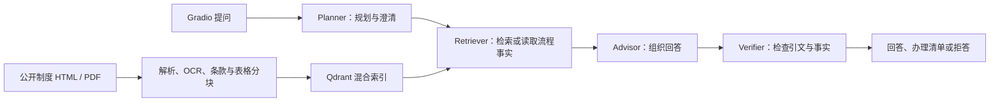

<div align="center">

# CampusGuide · 校园制度问答与办事指引

**让校园政策回答能查到原文，让办理步骤能按身份和情境逐项确认。**


[核心能力](#-核心能力) · [评测结果](#-评测结果) · [快速开始](#-快速开始) · [项目文档](docs/README.md)

</div>

---

## 📖 简介

CampusGuide 是面向华南农业大学公开制度的条款级问答与办事指引 Agent。它从制度原文检索条款和表格行，核验回答中的事实能否被引文支持；遇到国家奖学金申请、推免资格或在读证明等流程问题，会先补问必要条件，再按配置生成办理清单。

> 个人作品集项目，非学校官方服务。请勿输入学号、证件号码或成绩单，以学校公开文件和负责部门解释为准。


## ✨ 核心能力

| 能力 | 可以做什么 |
| --- | --- |
| 制度解析与入库 | 解析 HTML、PDF 和扫描页；保留表格行与父表、表头关系，以及文档版本、页码和来源 |
| 条款级混合检索 | bge-m3 向量与 BM25 词项检索经 RRF 融合、重排序，再按版本、受众和问题范围选择证据 |
| 证据核验 | 核对结论、引文与来源定位，区分完整回答、澄清、部分回答和拒答 |
| 多轮办事指引 | 通过流程配置收集身份与办理场景，输出可执行清单并展示关闭状态 |
| 会话演示 | Gradio 界面展示会话、引用与办理清单，支持历史恢复和运行进度 |

## 🔄 工作流



LangGraph 编排在线问答，MCP 提供检索和流程事实接口。离线语料构建、在线服务与 UI 的职责详见[系统架构](docs/architecture.md)。

## 📊 评测结果

项目记录的 **50 题全量 OCR 建库后实验**中，内容正确完整及合理路由通过 **43/50（86%）**，严格交付通过 **39/50（78%）**，Recall@12 为 **92.67%**，p95 问答耗时 **15.6 秒**。严格交付还检查正文是否完成归纳、是否误报缺项，以及核验是否完成。

这组数据来自作者的阶段实验汇总。公开仓库未附本轮逐题明细、完整运行配置和计时边界，不能把改进单独归因于 OCR，也不能用默认启动命令重现整组数字。历史版本、指标口径与复现边界见[评测说明](docs/evaluation.md)。

## 🚀 快速开始

### 体验界面：无需模型密钥或 Qdrant

需要 Python 3.11+ 和 [uv](https://docs.astral.sh/uv/getting-started/installation/)。在 Bash 或 WSL 中执行：

```bash
git clone https://github.com/kawayua/campusguide-agent.git
cd campusguide-agent
uv sync --locked
DEMO_FAKE=1 uv run --locked python -m campusguide.ui.app
```

打开 `http://127.0.0.1:7860/`。Fake 模式使用预设回复，适合查看多轮对话、引文和办理清单的界面，不用于验证检索或回答质量。可先试“国家奖学金怎么申请？”或“我要开在读证明”。

### 运行真实问答

真实模式需要 `.env` 模型配置、对应的本地语料和 Qdrant 索引。准备好后，在有 `make` 的 Bash/WSL 中执行 `make demo-preflight` 检查，随后运行 `make demo-up`（Docker）或 `make init-w2` 与 `make demo`（主机模式，需已启动 Qdrant）。首次准备会下载检索模型。详细步骤及公开数据边界见[部署说明](docs/quickstart.md)和[数据与来源](docs/data-sources.md)。
