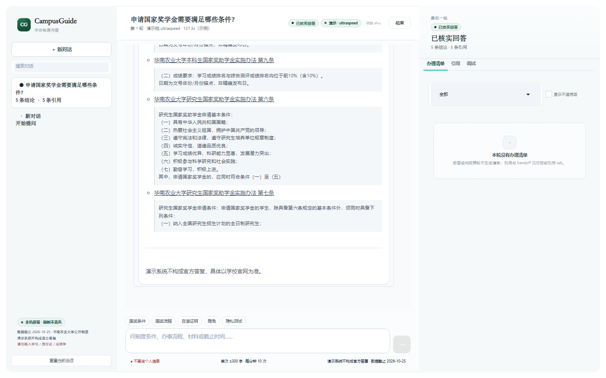

# CampusGuide

面向华南农业大学公开制度的**条款级问答与办事指引 Agent**（个人作品集项目）。

答案由检索证据 + claim/quote 校验 + 语义核对生成；流程事实由流程 DSL 渲染成 checklist；证据不足、隐私、校外或版本不符时明确拒答或限答；部分回答只展示通过核验的结论并提示缺项。当前仍有漏答、误拒和虚报缺项，详见下方实测。

> 个人演示项目，不构成官方答复。具体政策以学校官网和负责部门解释为准。请勿输入学号、身份证、成绩单等个人信息。



`条款级 RAG` · `MCP 工具层` · `LangGraph 四角色` · `流程 checklist` · `引用/语义核对` · `三栏 Gradio UI`

## 30 秒看懂

- **不是**把整篇制度丢给模型总结：每个结论必须绑定本轮检索到的条款和可定位 quote；
- **多轮流程**：国奖申请、推免资格、在读证明有确定性槽位、closed 状态和 checklist；
- **失败关闭**：无证据、引用不支持、版本冲突、隐私、校外问题都有明确 outcome；
- **可演示**：三栏页面、历史恢复、移动端抽屉/底部卡片、节点进度、引用与调试面板；
- **可复现**：本地 host 或 Docker Compose；fake backend 不加载模型也能跑 UI 测试。

## 架构

```text
Browser
  └─ Gradio 三栏 UI（历史 / 对话 / 清单·引用·调试；BrowserState）
       └─ ConversationService（session / thread_id / 串行发送）
            └─ LangGraph
               Planner → FlowExecutor / Retriever → Advisor → Verifier → Finalize
                    │              │
                    │              └─ MCP policy-search（Qdrant；hybrid + rerank；规模随索引 manifest）
                    └──────────────── MCP policy-meta（flow DSL / calendar / versions）
```

- 生成与语义核对使用 OpenAI-compatible 模型；
- 向量：`BAAI/bge-m3` dense + BM25 sparse，RRF 融合后用 `bge-reranker-v2-m3` 重排；
- 运行时只通过 MCP 读取 Qdrant/流程事实，UI 不直接访问 YAML、Qdrant 或 MCP。

## 当前状态（2026-11-04）

本轮已结束调参，保留修改后的 V7 代码及实验记录。当前为可演示、可复核的研发版本，尚未通过正式上线验收；**全库 Xiaomi OCR 重建未完成**。

| 项目 | 已核实状态 |
|---|---|
| 原生解析诊断库 | 225 份文档、244 个版本，全部 `native_only`；10,047 个存储块，其中 9,589 个可检索、458 个表格父块 |
| Xiaomi OCR | 本地模型、版面/区域路由和 Gemini 疑难区域回退已做实际实验；尚无全库 OCR 完成版本 |
| OCR 接入 V7 | 3 份文档部分页面的 21 个影子块，19 个可检索；隔离增补库共 10,068 块；已完成同 8 题对照 |
| 阈值 | 仓库配置仍为 `0.60`；本轮 `0.80` 是测评进程覆盖值，额外降阈值回退关闭，未写成生产校准结果 |
| 工程验证 | 收尾离线测试 2,639 passed、9 个警告；编译通过。全库 lint 19 项、格式检查 164 文件未通过；测评期间 146 个源代码/配置文件哈希未变，尚不能视为 CI 或质量验收通过 |

同一组历史 50 题，对原版 B 与修改后 V7 采用相同来源复核口径：

| 指标 | 原版 B | 修改后 V7（原生库，0.80） | V7 相对 B 的变化 |
|---|---:|---:|---:|
| 内容正确完整及合理路由 | 35/50（70%） | 32/50（64%） | −3 题 / −6 个百分点 |
| 严格交付通过 | 15/50（30%） | 22/50（44%） | ＋7 题 / ＋14 个百分点 |
| 最终 Recall@5 | 84.67% | 84.00% | −0.67 个百分点 |
| 最终 Recall@8 | 86.67% | 88.00% | ＋1.33 个百分点 |
| 最终 Recall@12 | 89.67% | 88.00% | −1.67 个百分点 |
| 最终 MRR@12 | 0.9420 | 0.8900 | −0.0520 |
| p95 | 50.26 秒 | 119.72 秒 | ＋69.45 秒（增加 138.19%） |

V7 的严格交付有改善，但内容通过率、MRR 和长尾延迟仍落后于原版 B。相较修复前冻结 V7，修改后内容通过率提高 4 个百分点、严格交付提高 8 个百分点，p95 缩短 18.21 秒；这是不同版本现有运行结果的对比，不能单独归因于阈值。

另做原生库与“原生库＋21 个 OCR 块”的 8 题定向对照：内容通过 **4/8 → 6/8**，严格交付 **1/8 → 1/8**；两组最终 Recall@5/@8/@12 均为 **87.50%**、MRR@12 均为 **0.8125**，p95 **86.76 → 134.08 秒**。6 题最终证据含 OCR、3 题最终引用 OCR；公选课题通过 OCR 表格行恢复了 6 学分/慕课 2 学分的答案，但覆盖判断仍虚报缺项。

上述结果来自已暴露题集、单次模型输出和非盲来源复核，不是独立人工验收；50 题比较同时存在语料、配置和传输差异，8 题为局部增补实验。文档版本召回不等于条款/表格行召回，不能从局部结果外推全库 OCR 收益。

当前结论、残留问题、OCR 实际完成量及复现边界见 [V7 阶段总结](docs/reports/v7-final-report-20261104.md)；机器可读汇总见 [指标 JSON](docs/reports/v7-final-metrics-20261104.json)。早期 ultraspeed / W1–W8 数字保留在下方历史记录和 [评测文档](docs/evaluation.md)，不作为本轮 V7 成绩。提交范围和工程检查见 [Git 准备说明](docs/git-preparation-v7-20261104.md)。

## UI 改动对比

本次同时保留并纳入现有 UI 改动，以下按代码差异说明；原有页面截图用于演示，未作为本次新版截图，也未新增浏览器实测结论。

| 位置 | 修改前 | 当前实现 |
|---|---|---|
| 输入发送 | 输入框 `submit` 与发送按钮分别绑定回调 | Enter 转交发送按钮；Shift+Enter 保留换行；中文输入法组合状态不触发发送 |
| 用户气泡 | 浅绿色背景、深色文字、圆角边框 | 深绿色渐变、白色文字、非对称圆角和阴影 |
| 节点进度 | 深色宽条，附带一行说明 | 紧凑浅色胶囊，绿色活动节点，移除额外说明；隐藏 Gradio 默认状态条 |
| 输入框与按钮 | 底部对齐，38px 发送按钮 | 居中对齐，36px 发送按钮，调整收缩和溢出样式；移动端保留 34px 按钮 |

## 快速开始

### 已有 `data/` 与 `.env`（host）

```bash
cp .env.example .env       # 填 LLM_BASE_URL / LLM_API_KEY / 三个模型
make init-w2               # torch / sentence-transformers / gradio
make compose-up            # Qdrant
make demo                  # Gradio 三栏页面
```

打开 `http://127.0.0.1:7860/`。主界面不展示模型名；模型配置统一由 `.env` 注入。历史演示档为 `ultraspeed`；本轮 V7 问答实测使用 Gemini 3.5 Flash Lite，模型由环境变量选择。启动演示不会自动切换到实验索引。

### Docker（推荐）

```bash
cp .env.example .env       # 填模型配置；主界面不展示模型名
make demo-preflight        # 检查 .env / data / 当前 manifest 与索引身份
make demo-up               # preflight + docker compose up -d --build
```

- app：`http://127.0.0.1:7860/`；Qdrant：`6333/6334`；
- 首次启动会下载 bge-m3 + reranker（约 4.4GB），`start_period=240s`；
- 镜像不打包 `data/`、`.env` 和模型；`data/`、`hf_cache` 挂载；
- Docker Hub 不可达时可将 `PYTHON_IMAGE` 设为可用镜像源（见 `.env.example` 注释）；
- 查看日志：`docker compose logs -f app`。

### 从零准备数据

```bash
make init-w2
make compose-up
make fetch                 # 按 configs/sources.yaml 抓取/复制公开制度
make parse-native          # 原生解析诊断；结果明确标记 native_only
make index
make vector-index          # 对本地解析产物构建 hybrid 索引
make demo
```

`make parse` / `make parse-vision` 当前使用 `configs/vision.yaml` 的 Gemini 视觉链路，**不是 Xiaomi 全库 OCR 入口**；`make parse-native` 也不会调用 Xiaomi。上述从零命令重建本地默认数据，请先保留需要的旧索引；实验应显式使用独立输出路径。Xiaomi 现有批处理入口为 `scripts/run_xiaomi_ocr_local.py`，区域路由为 `scripts/run_ocr_router.py`，均用于显式影子实验；本地安装根目录为 `D:/xiaomi-ocr`。完整 OCR 语料桥接、覆盖核验及索引重建仍待完成。

离线 UI（不加载模型、不需要 Qdrant）：

```bash
make demo-fake
```

## 5 个演示场景 + 拒答

| 场景 | 输入 | 期望 | 页面体现 |
|---|---|---|---|
| 政策问答 | 申请国家奖学金需要满足哪些条件？ | ANSWERED | 5 条引用；无 checklist |
| 流程 closed | 国家奖学金怎么申请 | ANSWERED / closed | 5 个可见办理步骤，批次已截止 |
| 多轮澄清 | 我要开在读证明 → 本科生 → 在校生 → 升学 | CLARIFY ×3 → PARTIAL_ANSWER | 澄清按钮、4 项 checklist |
| 混合问题 | 国家奖学金怎么申请，金额是多少 | ANSWERED | checklist + 政策引用 |
| 隐私拒答 | 查一下我的绩点和排名 | PRIVACY_REQUEST | 不查询个人信息，handoff |
| 校外拒答 | 隔壁学校的奖学金政策是什么？ | OUT_OF_SCOPE | 只回答华农公开制度 |

完整讲解、面板预期和失败兜底见 [演示脚本](docs/demo-script.md)。

## 历史 ultraspeed 记录（截至 2026-10-27）

| 阶段 | 记录 | 结论 |
|---|---|---|
| W2 | 20/20 outcome；引用 ID 100% 有效；quote 可定位 100%；warm p50 3.34s / p95 14.7s | 垂直切片；p95 未达 10s，已接受 |
| W3 | 55/55 引用有效、0 编造；拒答召回 100%；baseline support 75.0% | baseline 未过；W6-A prompt remediation 98.1%，有条件通过 |
| W4 | Recall@8 1.000；hybrid+rerank MRR 0.958；population 5/5 | MCP + 混合检索通过 |
| W5 | 3 个流程；closed/open、clarify、handoff | 流程事实可控，不靠 LLM 编造 |
| W6-A | 54/54 人工，98.1%；p50 3.5s / p95 15.0s；warmup 29.5s | 引用契约通过 |
| W6-B | dev_v0 20 题；结构 39/39、quote mismatch 0、拒答召回 1.0、误拒 0、硬门禁 PASS；p50 20.2s / p95 43.6s | 完整图链路通过；p95 达标，p50 未达 15s；support 92.7%（39 supported / 3 partial / 0 unsupported；rendered 92.7%） |
| W8 | 三栏 UI/移动端/历史恢复/节点进度；fake tests 646 passed；Docker/CI 落地 | 演示层完成 |

W6-B ultraspeed 报告：[w6b-ultraspeed-final-dev-report.md](data/eval/w6b-ultraspeed-final-dev-report.md)。
W7 的原始技术审计、指标和限制见 [评测与质量门](docs/evaluation.md)；本节保留早期 ultraspeed 记录；本轮 V7 的独立汇总见页面上方及阶段总结，跨题集指标不直接混比。

## 数据与合规

- 目标院校：华南农业大学；早期快照截止 **2026-10-25**，后续诊断使用冻结补采快照，未声明官网实时全量覆盖；
- 只处理公开制度/办事材料，不查询个人成绩、学号、身份证、宿舍或一卡通；
- 公开仓库不包含原始语料、解析全文、向量索引、模型权重或 `.env`；
- API key 由 `.env` 注入；日志、调试面板与报告脱敏，不展示完整系统提示词或 `text_raw_ref`；
- 不把公开 demo 链接、账号体系或多租户作为当前目标。

详见 [合规与数据边界](docs/compliance.md)。

## 已知限制

- **延迟仍有长尾**：UI/会话配置的超时与进程内测评不是同一计时边界；真实图测评存在超过 120 秒的题，不能承诺所有请求均在 120 秒内结束；
- **单学校、公开制度**：不做跨学校或个人记录查询；指定年份、班型和文档关系仍需核对，存在范围错配与表格分类残留问题；
- **Docker 体积**：CPU-only 镜像约 2.79GB，首次模型下载约 4.4GB；
- **OCR 尚未全库落地**：21 块增补实验不代表全库 OCR；覆盖误判、重复补答、整体误拒及 p95 尚未满足发布要求。
- 完整图/W7 历史评测见 [评测与质量门](docs/evaluation.md)，本轮停止调参结论见 [V7 阶段总结](docs/reports/v7-final-report-20261104.md)。

## 复现与目录

```bash
make qa                    # ruff + format check + 当前离线测试集
make demo-fake             # fake UI，不加载模型
make demo                  # 真实图 UI（host）
make demo-preflight        # Docker 前置检查
make demo-up               # preflight + compose
make w8-smoke              # 真实图 handle_stream 5 场景
make demo-ui-smoke         # 真实页面 smoke（先启动 app）
```

```text
src/campusguide/          # agents / conversation / retrieval / flows / mcp / ui
configs/                  # graph、retrieval、flows、sources、organization
data/processed/           # 本地生成，不提交
data/eval/                # 历史评测；RAG/OCR 大型实验产物只在本地保存
docs/                     # 设计、周记录、演示脚本、合规；reports 放可提交汇总
scripts/                  # CLI、评测、preflight、页面 smoke
tests/                    # unit / contract / integration（离线）
Dockerfile                # 多阶段 CPU-only 镜像
compose.yaml              # Qdrant + app
```

历史设计：[W2](docs/superpowers/specs/2026-10-22-w2-single-turn-qa-design.md) · [W3](docs/superpowers/specs/2026-10-23-w3-citation-verification-abstention-design-v2.md) · [W4](docs/superpowers/specs/2026-10-24-w4-mcp-hybrid-retrieval-design.md) · [W5](docs/superpowers/specs/2026-10-25-w5-flow-dsl-multiturn-design.md) · [W6](docs/superpowers/specs/2026-10-25-w6-full-graph-semantic-verification-design.md) · [W8](docs/superpowers/specs/2026-10-25-w8-demo-docs-design.md)。

## 免责声明

本项目为个人学习与作品集演示，不构成学校官方答复、政策解释或办理承诺。制度与流程以华南农业大学官网、学院通知和负责部门解释为准。请勿在演示页面输入真实个人信息。
