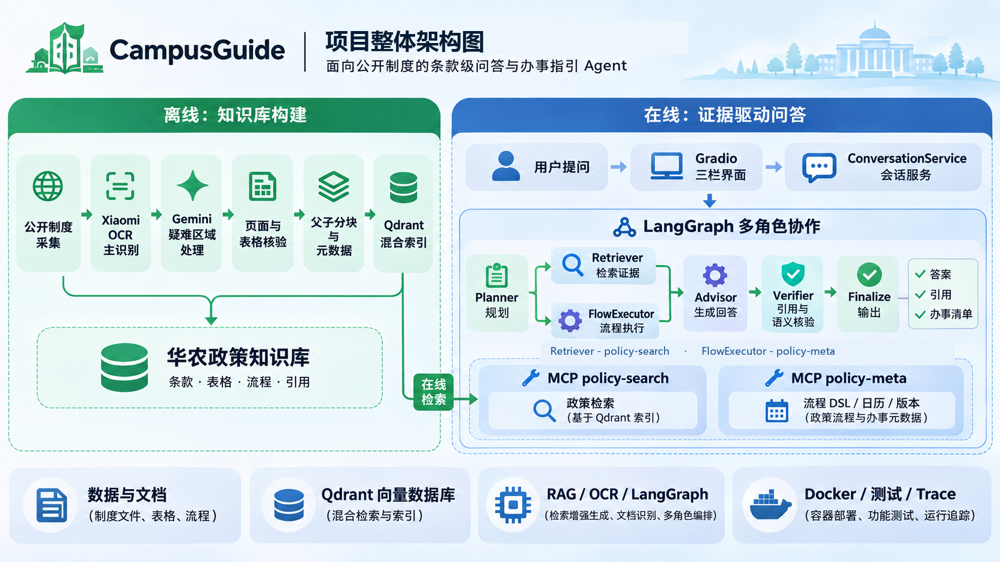

# 系统架构

CampusGuide 分为离线知识库构建和在线问答。离线层负责把公开文件转换为可追溯的证据；在线层选择适用证据、组织回答并核验；Gradio 界面读取会话和运行事件。

## 离线：把文档变成证据

1. `configs/sources.yaml` 登记公开来源和范围，采集保存来源 URL、文档版本及源文件身份。
2. HTML 和可读 PDF 可以走原生解析；最新全量 OCR 实验使用 Xiaomi OCR 主识别、Gemini 补充疑难区域，并核对页面覆盖、表格行列和跨页表头。这里的全量指本轮实验语料。
3. 正文按章节、条款分块。表格父块保留整体结构，行级子块关联表头及原页。块携带文档版本、页码、受众等元数据；实际可用字段取决于源文档和解析结果。
4. 从 `documents.jsonl`、`articles.jsonl` 和 manifest 对应的内容构建 Qdrant 索引，使用 bge-m3 dense 表示与 BM25 sparse 表示。

## 在线：选证据、组织回答、核验交付

| 环节 | 职责 |
| --- | --- |
| Planner | 识别政策问答、流程办理或混合问题，在缺少必要条件时向用户澄清 |
| Retriever / FlowExecutor | 通过 MCP `policy-search` 检索、RRF 融合和 bge-reranker-v2-m3 重排；通过 `policy-meta` 取流程、时间及版本等事实 |
| Advisor | 用 OpenAI-compatible 模型，根据检索到的条款和流程事实生成回答 |
| Verifier / Finalize | 检查结论、引文定位、事实支撑与覆盖情况，根据检查结果生成回答、部分回答、澄清或拒答 |

流程清单来自 `configs/flows/` 中的流程 DSL。`ConversationService` 管理会话状态和节点事件，界面展示回答、来源及办理步骤。隐私、校外问题、版本不适用或证据不足分别处理。

详见[部署与复现](quickstart.md)和[评测说明](evaluation.md)。
