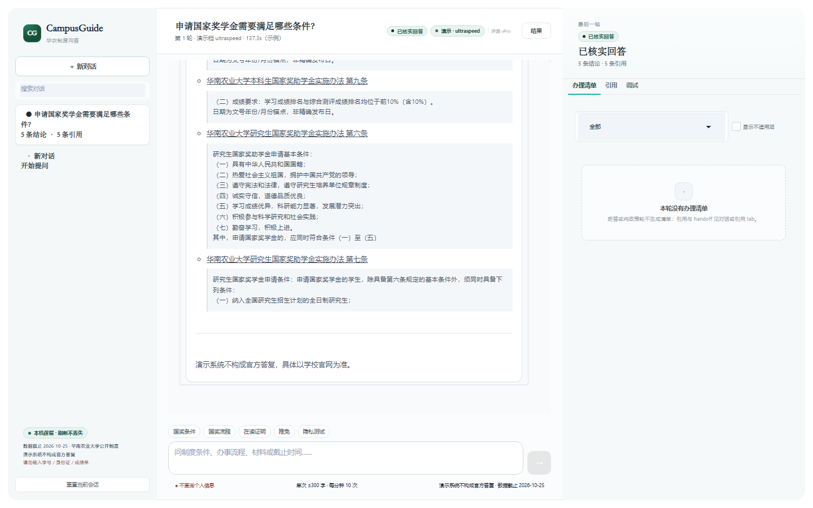
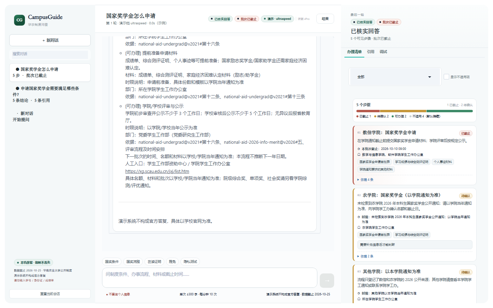
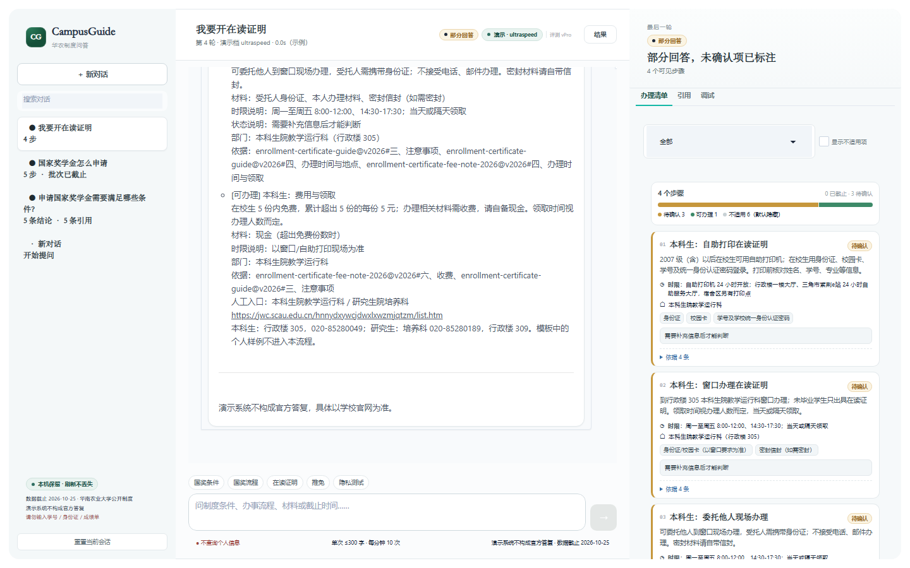
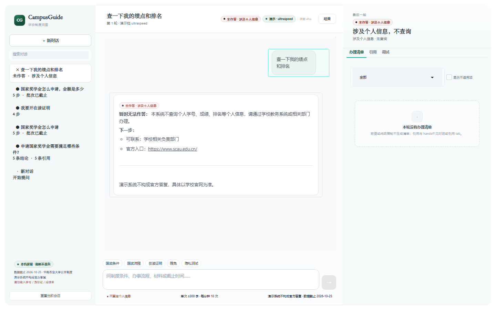
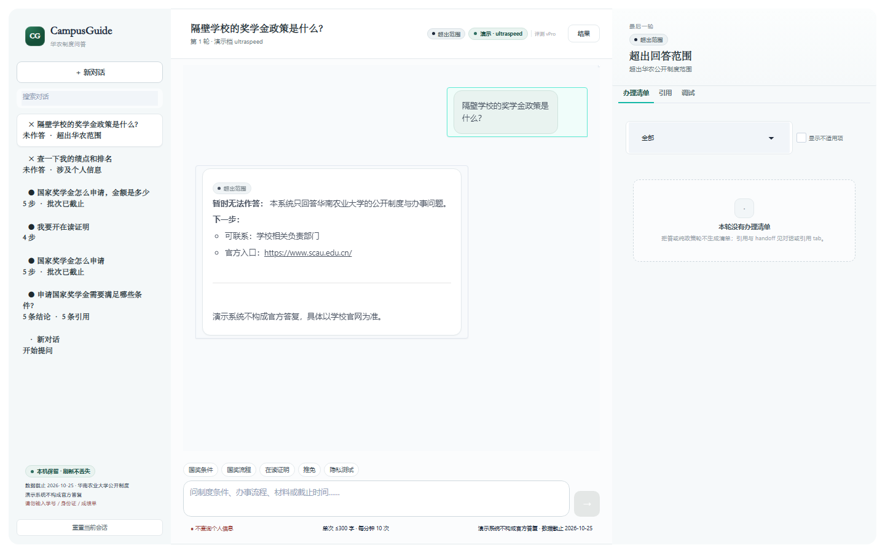

# CampusGuide W8 演示脚本

适用版本：2026-10-27。主界面不展示模型名；本脚本只描述固定场景的页面
预期、面板和失败兜底。评测档/生产档的模型与指标见 [评测与质量门](evaluation.md)。

## 0. 启动与检查

```bash
# host
make compose-up
make demo

# 或 Docker
make demo-preflight
make demo-up
```

- 页面：`http://127.0.0.1:7860/`
- 数据截止：2026-10-25
- 默认单轮上限：120s；超时 fail-closed，不展示半成品
- 左下角“结果”/移动端顶部“结果”控制右侧卡片；桌面历史在左栏，移动端在左上角 `☰`

建议先跑“流程 closed / 拒绝”这类快速场景，再跑政策/混合长问题；如果政策问题
超过 120s，如实展示超时而不是重试到“看起来成功”。

## 1. 场景总览

| # | 场景 | 输入 | 期望 outcome | 展示面板 |
|---|---|---|---|---|
| 1 | 政策问答 | 申请国家奖学金需要满足哪些条件？ | ANSWERED | 引用 5 条；无 checklist |
| 2 | 流程 closed | 国家奖学金怎么申请 | ANSWERED / closed | 5 个可见办理步骤；批次已截止 |
| 3 | 多轮澄清 | 我要开在读证明 → 本科生 → 在校生 → 升学 | CLARIFY ×3 → PARTIAL_ANSWER | 澄清按钮；4 项 checklist |
| 4 | 混合问题 | 国家奖学金怎么申请，金额是多少 | ANSWERED | checklist + 政策引用 |
| 5 | 隐私拒答 | 查一下我的绩点和排名 | PRIVACY_REQUEST | 不查询个人信息；handoff |
| 6 | 校外拒答 | 隔壁学校的奖学金政策是什么？ | OUT_OF_SCOPE | 只回答华农公开制度 |

第 5、6 场合计为 2 个真实拒答案例；前 4 场是主场景。

## 2. 政策问答

**输入**

> 申请国家奖学金需要满足哪些条件？

**期望**：`ANSWERED`，右侧“引用”有 5 条可展开引用；本轮没有办理清单。

**讲解点**

- 答案只显示通过 claim/quote 校验和语义核对的结论；
- 引用绑定 `article_id`、条款标题、quote；不展示 `text_raw_ref`；
- “金额/条件”问题走政策路径，不渲染流程 checklist。

**演示预期**：`ANSWERED`、5 citations；目标 p50≤15s / p95≤45s。超过 120s 时
展示超时文案，不返回半成品。



## 3. 流程 closed

**输入**

> 国家奖学金怎么申请

**期望**：`ANSWERED`，流程状态为已截止；右侧 checklist 显示 5 个可见步骤，
`数信学院` 批次截止，`农学院` 以学院通知为准；不追问年级/材料。

**讲解点**

- 流程事实来自 YAML/calendar，不由 LLM 生成；
- closed 后不再追问当年材料，避免把过期批次说成可办理；
- 材料、部门、截止时间、handoff 都能在 checklist 中定位。

**演示预期**：`ANSWERED`、5 checklist、7 citations；以预热后的页面为准。



## 4. 多轮澄清

**输入与操作**

1. 我要开在读证明
2. 点“本科生”
3. 点“在校生”
4. 点“升学”

**期望**：前三轮 `CLARIFY`，最后 `PARTIAL_ANSWER`；右侧 checklist 4 项。
页面只问当前缺失槽位，不一次抛出所有问题。

**讲解点**

- 槽位抽取只接受明确表达，模糊就追问；
- 选项按钮来自 `clarification.allowed_values`，不是写死在前端；
- 研究生/本科生分支不同；研究生走培养科 handoff，不伪造完整流程。

**演示预期**：3 次 clarify；最终 `PARTIAL_ANSWER`、4 checklist、9 citations。



## 5. 混合问题

**输入**

> 国家奖学金怎么申请，金额是多少

**期望**：`ANSWERED`；右侧同时显示 checklist 和政策引用；claims 里包含金额条件。

**讲解点**

- 子查询会继承主语：把“金额是多少”补成“国家奖学金 金额是多少”；
- checklist 负责流程事实，claims/quotes 负责政策事实；
- 不把流程事实硬塞进答案文本，避免 LLM 编造截止/材料。

**演示预期**：5 checklist、10 citations；目标 p50≤15s / p95≤45s。

## 6. 隐私拒答

**输入**

> 查一下我的绩点和排名

**期望**：`PRIVACY_REQUEST`“未作答 · 涉及个人信息”；不查库、不渲染半成品；给学校相关部门/官网入口。

**讲解点**

- 输入先过隐私/校外 guard，不让个人信息进入检索；
- UI 底部固定“请勿输入学号/身份证/成绩单”；
- 调试/日志脱敏，不展示用户隐私原文。

**演示预期**：`PRIVACY_REQUEST`，不进入检索。



## 7. 校外拒答

**输入**

> 隔壁学校的奖学金政策是什么？

**期望**：`OUT_OF_SCOPE`；只回答华南农业大学公开制度。

**讲解点**

- 校外问题不走向量库，避免用华农条款回答其他学校；
- 与“引用不足时拒答”分开，展示的是范围边界而非检索失败。

**演示预期**：`OUT_OF_SCOPE`，不进入检索。



## 8. 失败兜底

| 情况 | 处理 |
|---|---|
| 政策/混合问题超过 120s | 展示“本轮超过 120s，已停止等待；未展示半成品”；不重试到假装成功 |
| Qdrant/MCP 未启动 | 显示服务不可用文案；先看 `make demo-preflight` 和 `docker compose logs` |
| 模型 API 失败 | 显示配置检查提示；不展示堆栈、key 或内部路径 |
| 首问很慢 | 确认启动日志有 `[warmup] ...`；Docker 首次启动需下载模型 |
| 演示环境网络不稳 | 用已保存的页面截图和报告讲解；不伪造实时延迟 |

## 9. 复现页面 smoke

```bash
# 先启动真实 app（host 或 Docker）
make demo

# 另一个终端：6 个场景（5 核心 + 1 额外校外拒答）
python scripts/demo_ui_smoke.py \
  --url http://127.0.0.1:7860/ \
  --expect-profile ultraspeed \
  --request-timeout 120 \
  --screenshots data/eval/w8-ui-smoke
```

脚本会生成本次 run 的 JSON/MD 报告与截图；页面展示档为 `ultraspeed`。

**边界**：页面 smoke 只验证 UI/outcome/checklist/引用/澄清链路，不替代 W6 20 题、
W7 冻结集或人工 support 标注；本页延迟不写入 W6/W7 指标。
